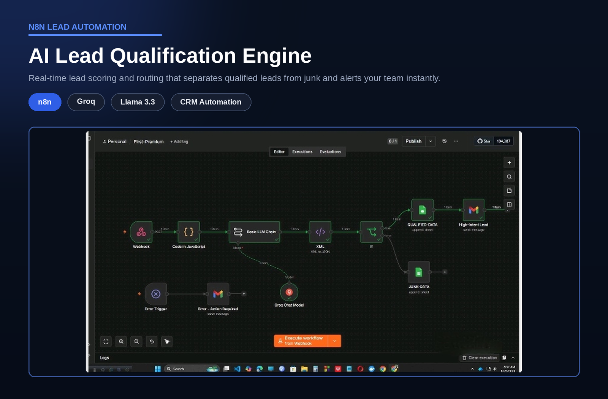

# AI Lead Qualification Engine

> Scores every inbound lead in real time, separates qualified leads from junk, and alerts the team when a qualified lead arrives.

## Overview

| | |
|---|---|
| **Category** | Sales and Lead Operations |
| **Key technologies** | n8n, Groq (Llama 3.3), Google Sheets, Gmail |
| **Type** | Personal project |
| **Workflow file** | [AI Lead Qualification Engine.json](../AI%20Lead%20Qualification%20Engine.json) |

## Business Problem

Sales teams receive leads from forms, ads and chat. Reading each one by hand is slow, and the leads most ready to buy sit in the same queue as spam and low-quality enquiries. The slower the first response, the more of those leads are lost.

## Solution

A webhook-triggered workflow reads each new lead as it arrives, uses an LLM to extract the key details (name, company, budget signals), applies qualification rules, and routes the lead automatically. Qualified leads are logged for the sales team and trigger an email alert. Junk is kept in a separate log.

## How It Works

1. A new lead is posted to the workflow through a webhook.
2. A JavaScript step cleans and prepares the incoming data.
3. An LLM chain (Llama 3.3 on Groq) extracts structured lead details and returns them as XML.
4. The XML is converted to JSON and a condition node checks the qualification rules.
5. Qualified leads are appended to the qualified-leads sheet and a high-intent lead alert is sent by email.
6. Junk leads are appended to a separate junk-leads sheet.
7. A separate Error Trigger branch emails an alert if any run fails, so no lead is lost silently.

## Business Value

- Faster response: qualified leads reach the team immediately instead of waiting in an inbox.
- Less manual triage: the team reviews only leads that passed the rules.
- Clean data: qualified and junk leads are stored separately, ready for reporting or CRM import.
- Reliable by design: failed runs raise an alert instead of disappearing.

## Tech Stack

| Component | Role |
|---|---|
| n8n | Workflow orchestration and error handling |
| Groq (Llama 3.3) | Extracts structured lead data from free text |
| Google Sheets | Qualified and junk lead logs |
| Gmail | Lead alerts and error notifications |

## Workflow Source

The full n8n workflow is in this repository: [AI Lead Qualification Engine.json](../AI%20Lead%20Qualification%20Engine.json). Click the file to read the workflow code.

## Setup

1. In n8n, choose Import from File and select the workflow JSON above.
2. Create your own credentials for each node that needs one:
   - Groq API key
   - Google Sheets OAuth2 (one sheet with a qualified tab and a junk tab)
   - Gmail OAuth2 (alerts and error emails)
3. Replace placeholder values (marked `YOUR_...`) with your own.
4. Point your lead source (website form, ad platform or CRM) at the workflow's webhook URL.
5. Run a test execution, then activate the workflow.

---

Built by [Md Yeasin Arafat](https://github.com/mdyeasinaraf07) | [LinkedIn](https://www.linkedin.com/in/md-yeasin-arafat-848387254) | [Portfolio](https://mdyeasinarafat-portfolio.lovable.app)
