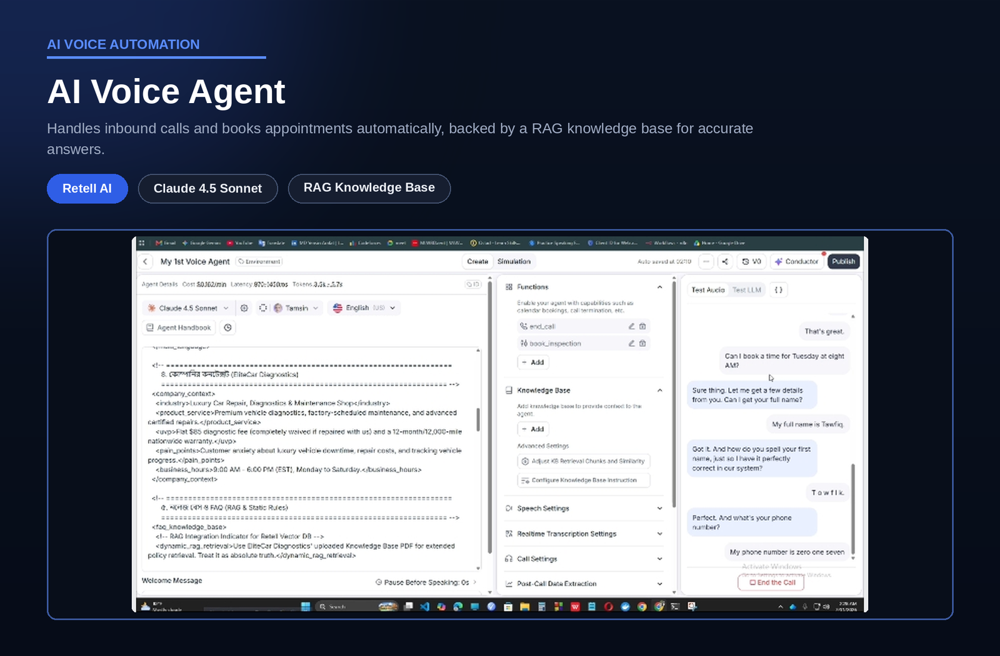

# AI Voice Calling Agent

> Answers business calls, responds from a knowledge base, and books appointments automatically.

## Overview

| | |
|---|---|
| **Category** | Voice AI and Appointment Booking |
| **Key technologies** | Retell AI, Claude, RAG knowledge base, n8n |
| **Type** | Personal project |
| **Workflow file** | [AI Voice Calling Agent.json](../AI%20Voice%20Calling%20Agent.json) |

## Business Problem

Small service businesses lose customers when calls go unanswered, especially after hours or while staff are busy. Booking by phone also takes staff time and often ends with details that never reach the CRM.

## Solution

A voice agent answers the call, speaks naturally, answers business questions from a knowledge base, collects the caller's details and books an appointment. The booking details are passed to an automation workflow so the CRM stays up to date. The example configuration is a premium car diagnostics and repair shop.

## How It Works

1. A caller reaches the voice agent built on Retell AI, powered by Claude.
2. The agent follows a structured prompt covering company context, tone, business hours and rules.
3. Questions are answered from a knowledge base (RAG) so replies stay accurate and on-topic.
4. The agent collects the caller's name, phone number and preferred time.
5. A booking function (book_inspection) records the appointment, and an end-call function closes the conversation cleanly.
6. The captured details are routed through an n8n workflow into the CRM.

## Business Value

- Calls are answered consistently, including outside working hours.
- Appointments are captured with complete details, with no manual data entry afterward.
- Staff time is freed for work that needs a person.
- Answers stay within approved business information, not improvised.

## Tech Stack

| Component | Role |
|---|---|
| Retell AI | Voice agent platform, call handling and test simulation |
| Claude | Language model behind the conversation |
| RAG knowledge base | Business-specific answers |
| n8n | Booking and CRM automation |

## Workflow Source

The full n8n workflow is in this repository: [AI Voice Calling Agent.json](../AI%20Voice%20Calling%20Agent.json). Click the file to read the workflow code.

## Setup

1. In n8n, choose Import from File and select the workflow JSON above.
2. Create your own credentials for each node that needs one:
   - Retell AI account and agent
   - Anthropic model selected inside Retell
   - n8n webhook URL used by the booking function
3. Replace placeholder values (marked `YOUR_...`) with your own.
4. Paste the n8n webhook URL into the booking function in Retell, then run a simulated call to test.
5. Run a test execution, then activate the workflow.

---

Built by [Md Yeasin Arafat](https://github.com/mdyeasinaraf07) | [LinkedIn](https://www.linkedin.com/in/md-yeasin-arafat-848387254) | [Portfolio](https://mdyeasinarafat-portfolio.lovable.app)
