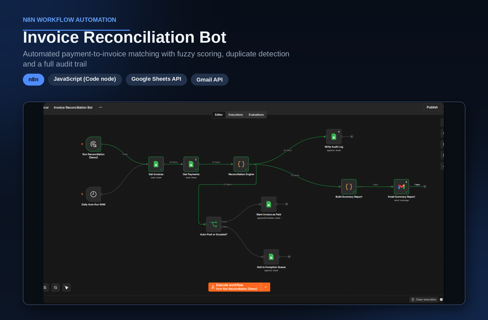

# Invoice Reconciliation Bot

> Matches incoming payments to open invoices with weighted scoring, flags duplicates and exceptions, and keeps a full audit trail.

## Overview

| | |
|---|---|
| **Category** | Finance Operations |
| **Key technologies** | n8n, JavaScript (Code node), Google Sheets, Gmail |
| **Type** | Personal project |
| **Workflow file** | [Invoice Reconciliation Bot.json](../Invoice%20Reconciliation%20Bot.json) |

## Business Problem

Finance teams spend hours matching bank payments to open invoices. References are inconsistent, amounts are partial or too high, names differ, and duplicates slip in. Manual matching is slow, and errors lead to wrongly closed invoices or unnecessary payment reminders.

## Solution

The workflow scores every payment against open invoices using reference text, amount, sender name and payment date. Only high-confidence matches are posted automatically. Partial payments, overpayments, duplicates and unclear payments go to an exception queue for a person to review. Every decision is written to an audit log.

## How It Works

1. The workflow starts manually or on a daily 9 AM schedule.
2. Open invoices and incoming payments are read from Google Sheets.
3. The Reconciliation Engine (a JavaScript step) scores each payment against every open invoice.
4. Each payment receives a status: Matched, Partial, Overpaid, Duplicate, Needs Review or Unmatched.
5. Every result is written to the audit log.
6. Only Matched payments are auto-posted: the invoice is marked as paid.
7. All other payments are added to the exception queue.
8. A summary report is built and emailed through Gmail.

### Scoring Logic

Each payment is scored against every open invoice. Payments with a score of 80 or more and a clean match are auto-posted.

| Signal | Points |
|---|---|
| Exact invoice ID found in the payment reference | 50 |
| Partial invoice ID match in the reference | 40 |
| Exact amount | 30 |
| Amount within 2% tolerance | 20 |
| Customer name similarity of 90% or more | 15 |
| Customer name similarity of 75% or more | 8 |
| Payment date within 15 days of the due date | 5 |

Special handling: a payment that references several invoices is sent to review with the combined invoice total. A second payment for an already settled invoice is marked Duplicate. A short or excess payment against a matched invoice is marked Partial or Overpaid.

## Business Value

- Routine matches are handled automatically, so finance staff focus on exceptions.
- Only high-confidence matches are auto-posted. Everything else is reviewed by a person.
- The audit log records the status, score and reasons for each decision.
- A daily summary keeps the team informed without opening the sheets.
- The Sheets inputs can be replaced with real bank and invoice data without redesigning the logic.

## Tech Stack

| Component | Role |
|---|---|
| n8n | Workflow orchestration and scheduling |
| JavaScript (Code node) | Weighted fuzzy-matching engine and report builder |
| Google Sheets | Invoices, payments, exception queue and audit log |
| Gmail | Summary email |

## Demo Data

The workflow was tested on synthetic data with 20 invoices and 22 payments. 11 payments were auto-matched and the rest went through the exception path. No real financial data is included.

## Workflow Source

The full n8n workflow is in this repository: [Invoice Reconciliation Bot.json](../Invoice%20Reconciliation%20Bot.json). Click the file to read the workflow code.

## Setup

1. In n8n, choose Import from File and select the workflow JSON above.
2. Create your own credentials for each node that needs one:
   - Google Sheets OAuth2 (a spreadsheet with Invoices, Payments, Exceptions and Audit_Log tabs)
   - Gmail OAuth2 (summary email)
3. Replace placeholder values (marked `YOUR_...`) with your own.
4. Fill the Invoices and Payments tabs with your own data, or keep the demo data for a first test.
5. Run a test execution, then activate the workflow.

---

Built by [Md Yeasin Arafat](https://github.com/mdyeasinaraf07) | [LinkedIn](https://www.linkedin.com/in/md-yeasin-arafat-848387254) | [Portfolio](https://mdyeasinarafat-portfolio.lovable.app)
