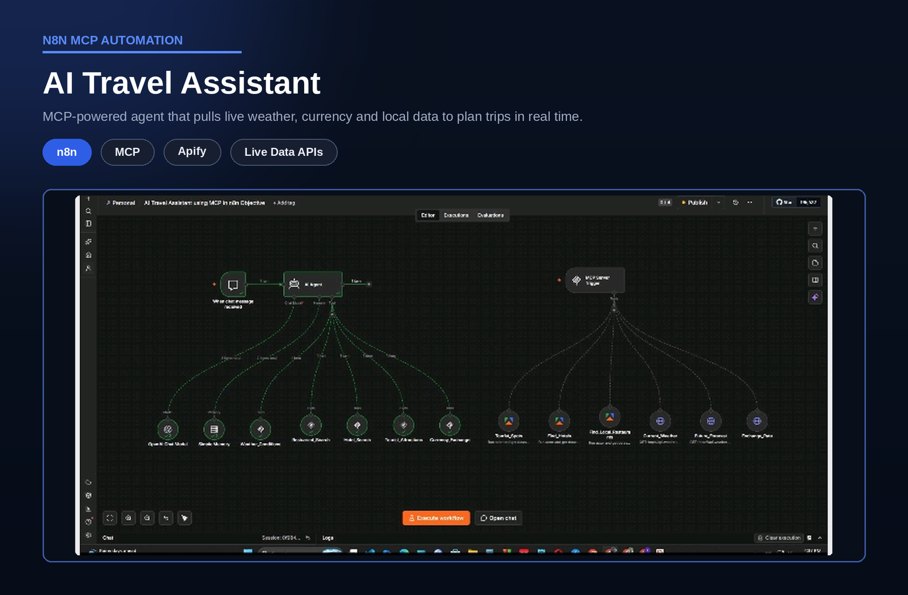

# MCP-Powered AI Travel Assistant

> An AI agent that plans trips using live weather, currency, hotel, restaurant and attraction data instead of outdated model knowledge.

## Overview

| | |
|---|---|
| **Category** | AI Agent with Live Data |
| **Key technologies** | n8n, Model Context Protocol (MCP), Apify, OpenAI |
| **Type** | Personal project |
| **Workflow file** | [AI Travel Assistant using MCP in n8n Objective.json](../AI%20Travel%20Assistant%20using%20MCP%20in%20n8n%20Objective.json) |

## Business Problem

A language model alone cannot answer questions that depend on current information such as today's weather, exchange rates or nearby hotels. Answers built on stale knowledge lead to poor travel decisions.

## Solution

The assistant is an n8n agent that decides which tools it needs and calls them through the Model Context Protocol. The same tools are published from an MCP Server Trigger, so other AI agents and applications can reuse them.

## How It Works

1. A user sends a travel question through chat.
2. The AI agent (OpenAI) interprets the request and keeps short conversation memory.
3. It calls only the tools the question needs, through MCP: weather, currency exchange, hotels, restaurants and tourist attractions.
4. Current weather and forecasts come from WeatherAPI, exchange rates from an exchange-rate API, and hotels, restaurants and attractions from Apify actors.
5. Live results are combined into a single concise answer.
6. The same tool set is exposed by an MCP Server Trigger, so any MCP-compatible client can connect to it.

## Business Value

- Answers reflect real-time conditions, not training data.
- Tools are built once and reused by any MCP-compatible agent.
- A clear pattern for connecting AI to company systems and data sources.

## Tech Stack

| Component | Role |
|---|---|
| n8n | Agent and workflow orchestration |
| Model Context Protocol | Standard interface between the agent and its tools |
| OpenAI | Chat model for the agent |
| Apify | Hotels, restaurants and tourist attractions |
| WeatherAPI | Current weather and forecast |
| Exchange-rate API | Currency conversion rates |

## Workflow Source

The full n8n workflow is in this repository: [AI Travel Assistant using MCP in n8n Objective.json](../AI%20Travel%20Assistant%20using%20MCP%20in%20n8n%20Objective.json). Click the file to read the workflow code.

## Setup

1. In n8n, choose Import from File and select the workflow JSON above.
2. Create your own credentials for each node that needs one:
   - OpenAI API key
   - Apify OAuth2 or API token
   - WeatherAPI key
3. Replace placeholder values (marked `YOUR_...`) with your own.
4. Activate the workflow to get the MCP server URL, then connect any MCP-compatible client to it.
5. Run a test execution, then activate the workflow.

---

Built by [Md Yeasin Arafat](https://github.com/mdyeasinaraf07) | [LinkedIn](https://www.linkedin.com/in/md-yeasin-arafat-848387254) | [Portfolio](https://mdyeasinarafat-portfolio.lovable.app)
