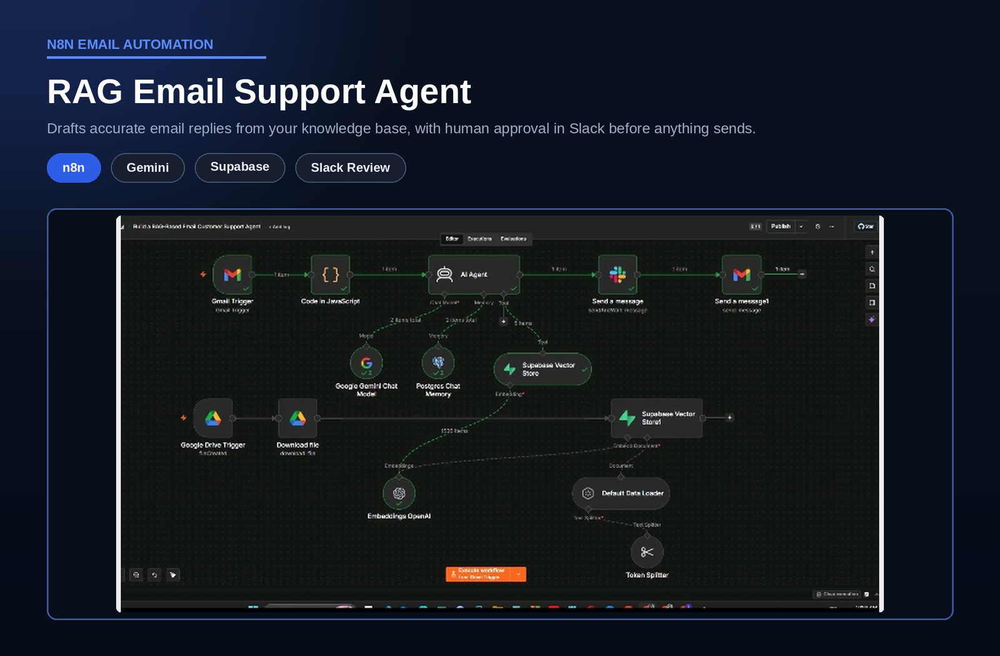

# RAG Email Support Agent

> Drafts accurate replies to customer emails from the company's own knowledge base, with human approval in Slack before anything is sent.

## Overview

| | |
|---|---|
| **Category** | Customer Support |
| **Key technologies** | n8n, Google Gemini, Supabase vector store, Slack, Gmail |
| **Type** | Personal project |
| **Workflow file** | [Build a RAG-Based Email Customer Support Agent.json](../Build%20a%20RAG-Based%20Email%20Customer%20Support%20Agent.json) |

## Business Problem

Support inboxes fill up with repeat questions that already have answers in internal documents. Answering them manually is slow and inconsistent, and a fully automatic AI reply is risky because a wrong answer reaches the customer directly.

## Solution

An AI agent reads each incoming email, searches a vector store built from the company's documents, and drafts a reply grounded in that content. The draft is posted to Slack with Approve and Reject buttons, and the email is sent only after a person approves it.

## How It Works

1. Gmail is checked every minute and a new email triggers the workflow.
2. A JavaScript step removes HTML, signatures and extra whitespace from the message.
3. The AI agent (Google Gemini) searches the Supabase vector store for relevant company knowledge and uses Postgres chat memory for context.
4. The drafted reply and the original question are posted to a Slack approval channel, and the workflow waits for Approve or Reject.
5. After approval, the reply is sent to the customer through Gmail.
6. In parallel, a Google Drive trigger watches the knowledge-base folder. Each new file is downloaded, split into chunks, embedded with OpenAI embeddings and stored in Supabase, so the knowledge base stays current.

## Business Value

- Consistent answers drawn from approved company documents, not model guesses.
- Human control: nothing is sent without sign-off, which keeps tone and accuracy under the team's control.
- Faster drafting: staff review and approve instead of writing from scratch.
- Easy to maintain: adding a document to the Drive folder updates the agent's knowledge.

## Agent Behavior

- Answers only from the retrieved documents and says so when the information is missing.
- Cites the source file and page after each answer.
- Refers frustrated customers, or customers who ask for a person, to the human support contact.

## Tech Stack

| Component | Role |
|---|---|
| n8n | Workflow orchestration |
| Google Gemini | Chat model that drafts replies |
| Supabase (vector store) | Stores and searches document embeddings |
| OpenAI Embeddings | Converts documents to vectors |
| Postgres | Chat memory |
| Google Drive | Knowledge-base source |
| Slack | Human approval step |
| Gmail | Incoming and outgoing email |

## Workflow Source

The full n8n workflow is in this repository: [Build a RAG-Based Email Customer Support Agent.json](../Build%20a%20RAG-Based%20Email%20Customer%20Support%20Agent.json). Click the file to read the workflow code.

## Setup

1. In n8n, choose Import from File and select the workflow JSON above.
2. Create your own credentials for each node that needs one:
   - Gmail OAuth2
   - Google Gemini API key
   - Supabase project with a vector table (1536-dimension embeddings)
   - Postgres connection for chat memory
   - OpenAI API key (embeddings)
   - Google Drive OAuth2 (watched knowledge-base folder)
   - Slack app and approval channel
3. Replace placeholder values (marked `YOUR_...`) with your own.
4. Add documents to the watched Drive folder so the knowledge base is populated before testing.
5. Run a test execution, then activate the workflow.

---

Built by [Md Yeasin Arafat](https://github.com/mdyeasinaraf07) | [LinkedIn](https://www.linkedin.com/in/md-yeasin-arafat-848387254) | [Portfolio](https://mdyeasinarafat-portfolio.lovable.app)
