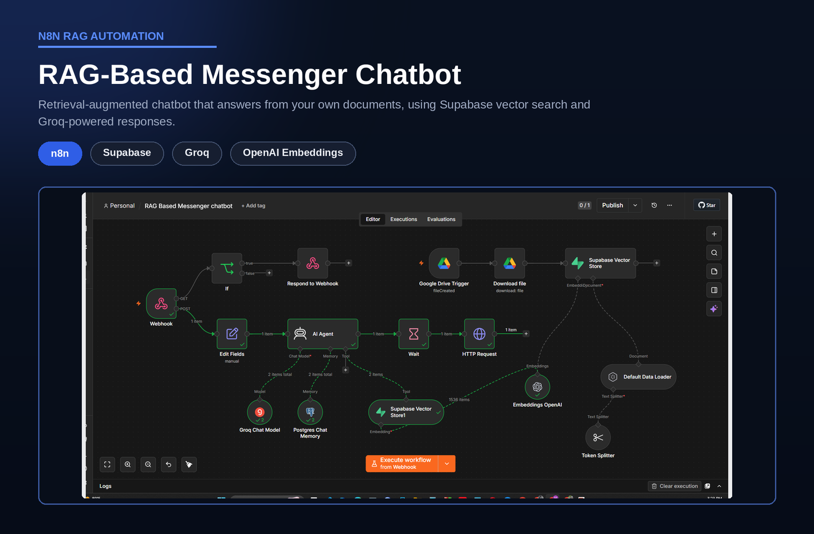

# RAG Messenger Support Agent

> A chatbot that answers customer questions on Facebook Messenger from the company's own documents.

## Overview

| | |
|---|---|
| **Category** | Customer Support |
| **Key technologies** | n8n, Groq, Supabase pgvector, OpenAI Embeddings, Google Drive, Meta Graph API |
| **Type** | Personal project |
| **Workflow file** | [RAG Based Messenger chatbot.json](../RAG%20Based%20Messenger%20chatbot.json) |

## Business Problem

Customers message businesses at all hours, and the same questions about prices, policies and availability repeat daily. Small teams cannot reply instantly around the clock, and slow replies cost sales.

## Solution

A retrieval-augmented chatbot answers Messenger messages from the company's own documents. It remembers the conversation, grounds every reply in retrieved content, cites its source, and directs customers to human support when it cannot help.

## How It Works

1. A customer message reaches the workflow through a webhook. The GET route handles Meta's webhook verification and the POST route handles messages.
2. The sender and page IDs are extracted and the message is passed to the AI agent.
3. The agent (Groq chat model) retrieves relevant passages from the Supabase vector store and uses Postgres chat memory for context.
4. The reply is sent back to the customer through the Meta Graph API.
5. Separately, a Google Drive trigger ingests every new document: it is downloaded, split into chunks, embedded with OpenAI embeddings and stored in Supabase.

## Business Value

- Instant answers outside working hours.
- Replies come from approved company documents, so they stay accurate.
- Staff handle only the cases that need a person.
- Updating the knowledge base is as simple as adding a file to a folder.

## Agent Behavior

- Answers only from the retrieved documents and says so when the information is missing.
- Combines facts from several document chunks into one complete answer.
- Cites the source file and page after each answer, and keeps replies short.
- Refers frustrated customers, or customers who ask for a person, to the human support contact.

## Tech Stack

| Component | Role |
|---|---|
| n8n | Workflow orchestration |
| Groq | Fast chat model for replies |
| Supabase (pgvector) | Vector search over company documents |
| OpenAI Embeddings | Converts documents to vectors |
| Postgres | Conversation memory |
| Google Drive | Knowledge-base source |
| Meta Graph API | Facebook Messenger channel |

## Workflow Source

The full n8n workflow is in this repository: [RAG Based Messenger chatbot.json](../RAG%20Based%20Messenger%20chatbot.json). Click the file to read the workflow code.

## Setup

1. In n8n, choose Import from File and select the workflow JSON above.
2. Create your own credentials for each node that needs one:
   - Meta developer app (webhook verify token and page access token)
   - Groq API key
   - Supabase project with pgvector enabled
   - Postgres connection for chat memory
   - OpenAI API key (embeddings)
   - Google Drive OAuth2
3. Replace placeholder values (marked `YOUR_...`) with your own.
4. Register the workflow's webhook URL in your Meta app and add documents to the watched Drive folder before testing.
5. Run a test execution, then activate the workflow.

---

Built by [Md Yeasin Arafat](https://github.com/mdyeasinaraf07) | [LinkedIn](https://www.linkedin.com/in/md-yeasin-arafat-848387254) | [Portfolio](https://mdyeasinarafat-portfolio.lovable.app)
